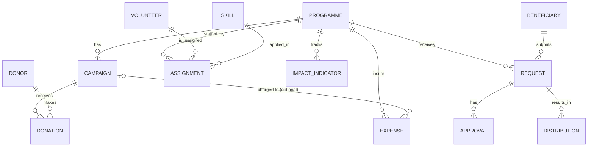

# ER Model, Functional Dependencies and Normalization (1NF -> 3NF)

## 1. Changes made to the Review-1 design (and why)

| # | Change | Reason |
|---|---|---|
| 1 | **Removed `beneficiary_id` from DISTRIBUTION** | `distribution_id -> request_id -> beneficiary_id` is a *transitive dependency* (3NF violation, and an update anomaly). The beneficiary is reached through REQUEST. |
| 2 | Added `requested_amount` to REQUEST | Lets the database check "approved <= requested"; needed for amount-based business rules. |
| 3 | Added `end_date` to ASSIGNMENT (`assignment_date` = start) | A period is required to detect *overlapping* assignments. |
| 4 | Added optional `campaign_id` to EXPENSE | Needed for the "Fund Utilization by Campaign" report (see section 6 for the 3NF note). |
| 5 | Status values / ENUMs, REQUEST status `Cancelled` | Controlled vocabularies and life-cycle for requests. |

All 13 Review-1 entities and all Review-1 relationships are preserved.

## 2. ER model (final)



Every relationship is **1:M**: the "many" side holds the foreign key of the "one" side. VOLUNTEER/SKILL/PROGRAMME are
related M:N:N and are resolved by the associative entity ASSIGNMENT (which also stores role and period).

## 3. Normalization walk-through (from unnormalized data)

### 3.1 Unnormalized form (UNF) - one big spreadsheet
`NGO_SHEET(donation_id, donor_name, donor_email, donor_phone, campaign_name, programme_name, programme_status, amount, date, volunteer_name, skills, role ...)`

Problems: repeating values (donor details repeated for every donation), multi-valued cell `skills = "First Aid, Teaching"`,
update / insert / delete anomalies.

### 3.2 First Normal Form (1NF) - atomic values, no repeating groups
* Rule: every column holds one atomic value; every row is uniquely identifiable by a key.
* Fix: the multi-valued `skills` cell becomes one row per (volunteer, skill, programme) -> the ASSIGNMENT relation with `assignment_id` as key.
  Every table in the schema has a primary key and only atomic columns (dates, numbers, single text values; ENUMs hold one value).

### 3.3 Second Normal Form (2NF) - no partial dependency on a composite key
Example of a violation (before):
`VOLUNTEER_ACTIVITY(volunteer_id, programme_id, assignment_date, volunteer_name, volunteer_email, programme_name, role)` with key
`(volunteer_id, programme_id, assignment_date)`:
* `volunteer_id -> volunteer_name, volunteer_email` (depends on part of the key)
* `programme_id -> programme_name` (depends on part of the key)

Fix: decompose into VOLUNTEER(volunteer_id, name, email, ...), PROGRAMME(programme_id, programme_name, ...) and
ASSIGNMENT(assignment_id, volunteer_id, skill_id, programme_id, assignment_date, end_date, role).
In the final schema every table uses a **single-column surrogate primary key**, so a partial dependency is impossible by construction.

### 3.4 Third Normal Form (3NF) - no transitive dependency
Example of a violation (before): `DONATION_FLAT(donation_id, donor_id, donor_name, donor_email, campaign_id, campaign_name, programme_id, programme_name, amount)`
* `donation_id -> donor_id -> donor_name, donor_email` (transitive)
* `donation_id -> campaign_id -> campaign_name, programme_id -> programme_name` (transitive)

Fix: DONOR, CAMPAIGN, PROGRAMME, DONATION(donation_id, donor_id, campaign_id, ...). Donation keeps only the two foreign keys.
The same reasoning produced the Review-1 correction `DISTRIBUTION(request_id)` instead of `(request_id, beneficiary_id)`.

## 4. Functional dependencies, keys and 3NF check per relation

Notation: **PK** primary key, **CK** other candidate keys, FK foreign key. In each relation the *only* determinants are
candidate keys, so every non-key attribute depends on "the key, the whole key and nothing but the key" (this is even BCNF).

| Relation | PK | Other candidate keys | Functional dependencies | FKs |
|---|---|---|---|---|
| PROGRAMME | programme_id | programme_name | programme_id -> programme_name, description, start_date, end_date, status; programme_name -> programme_id | - |
| CAMPAIGN | campaign_id | (programme_id, campaign_name) | campaign_id -> programme_id, campaign_name, description, start_date, end_date, target_amount | programme_id -> PROGRAMME |
| DONOR | donor_id | email, phone | donor_id -> donor_name, email, phone, donor_type; email -> donor_id; phone -> donor_id | - |
| DONATION | donation_id | - | donation_id -> donor_id, campaign_id, donation_date, amount, payment_method | donor_id -> DONOR; campaign_id -> CAMPAIGN |
| BENEFICIARY | beneficiary_id | contact | beneficiary_id -> name, contact, address, category; contact -> beneficiary_id | - |
| REQUEST | request_id | - | request_id -> beneficiary_id, programme_id, request_date, description, requested_amount, status | beneficiary_id -> BENEFICIARY; programme_id -> PROGRAMME |
| APPROVAL | approval_id | - | approval_id -> request_id, approval_date, approved_amount, status | request_id -> REQUEST |
| DISTRIBUTION | distribution_id | - | distribution_id -> request_id, distribution_date, amount_or_quantity, distribution_type | request_id -> REQUEST |
| VOLUNTEER | volunteer_id | email, phone | volunteer_id -> name, email, phone, availability; email -> volunteer_id; phone -> volunteer_id | - |
| SKILL | skill_id | skill_name | skill_id -> skill_name, description; skill_name -> skill_id | - |
| ASSIGNMENT | assignment_id | - | assignment_id -> volunteer_id, skill_id, programme_id, assignment_date, end_date, role | volunteer_id -> VOLUNTEER; skill_id -> SKILL; programme_id -> PROGRAMME |
| EXPENSE | expense_id | - | expense_id -> programme_id, campaign_id, expense_date, amount, description, category | programme_id -> PROGRAMME; (campaign_id, programme_id) -> CAMPAIGN |
| IMPACT_INDICATOR | impact_id | (programme_id, indicator_name, measurement_date) | impact_id -> programme_id, indicator_name, target_value, actual_value, measurement_date | programme_id -> PROGRAMME |

Derived values (funds received, total spent, utilisation %, achievement %, remaining amount) are **not stored**; they are
computed by views, so there is no redundant data to keep consistent.

## 5. Final 3NF relational schema

```
PROGRAMME(programme_id PK, programme_name UQ, description, start_date, end_date, status)
CAMPAIGN(campaign_id PK, programme_id FK, campaign_name, description, start_date, end_date, target_amount)
DONOR(donor_id PK, donor_name, email UQ, phone UQ, donor_type)
DONATION(donation_id PK, donor_id FK, campaign_id FK, donation_date, amount, payment_method)
BENEFICIARY(beneficiary_id PK, name, contact UQ, address, category)
REQUEST(request_id PK, beneficiary_id FK, programme_id FK, request_date, description, requested_amount, status)
APPROVAL(approval_id PK, request_id FK, approval_date, approved_amount, status)
DISTRIBUTION(distribution_id PK, request_id FK, distribution_date, amount_or_quantity, distribution_type)
VOLUNTEER(volunteer_id PK, name, email UQ, phone UQ, availability)
SKILL(skill_id PK, skill_name UQ, description)
ASSIGNMENT(assignment_id PK, volunteer_id FK, skill_id FK, programme_id FK, assignment_date, end_date, role)
EXPENSE(expense_id PK, programme_id FK, campaign_id FK NULL, expense_date, amount, description, category)
IMPACT_INDICATOR(impact_id PK, programme_id FK, indicator_name, target_value, actual_value, measurement_date)
```

## 6. Honest notes on the two places that need explanation

1. **EXPENSE (campaign_id, programme_id).** Strictly, `campaign_id -> programme_id` holds for rows where a campaign is given,
   so `expense_id -> campaign_id -> programme_id` is a transitive dependency. It is kept on purpose because (a) Review-1 requires
   every expense to belong to a programme, including programme-level expenses with no campaign, and (b) the campaign report needs
   campaign-level expenses. The redundancy **cannot become inconsistent**: the composite foreign key
   `FOREIGN KEY (campaign_id, programme_id) REFERENCES campaign(campaign_id, programme_id)` makes the database reject any expense whose
   campaign belongs to a different programme (tested: T37). If a strictly-3NF-only schema is required, drop `expense.campaign_id`
   (this returns exactly to the Review-1 table); the campaign-level expense column of the fund report would then be removed.
2. **REQUEST.status vs APPROVAL.status.** These are different attributes of different relations (the request's life-cycle vs. one
   decision record), so there is no FD violation inside either relation. Consistency between them is *enforced by triggers*
   (`trg_approval_ai`, `trg_request_bu`, `sp_sync_request_status`): status Approved/Rejected can only be reached through an APPROVAL row.
